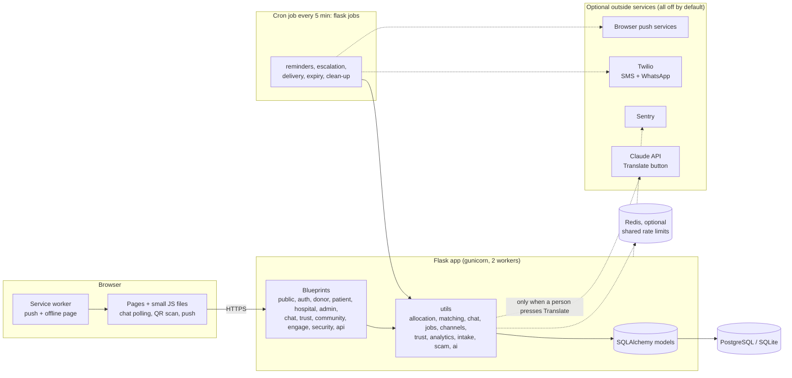
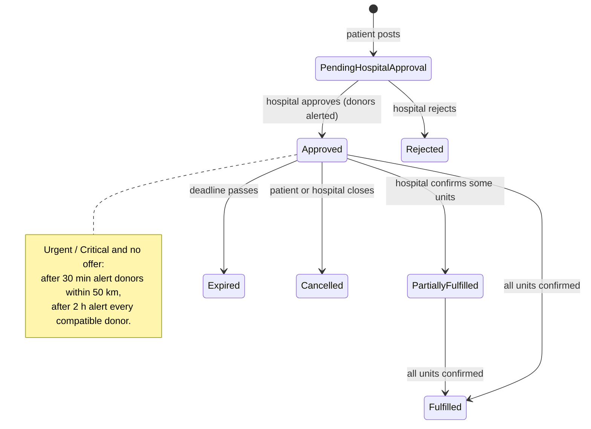
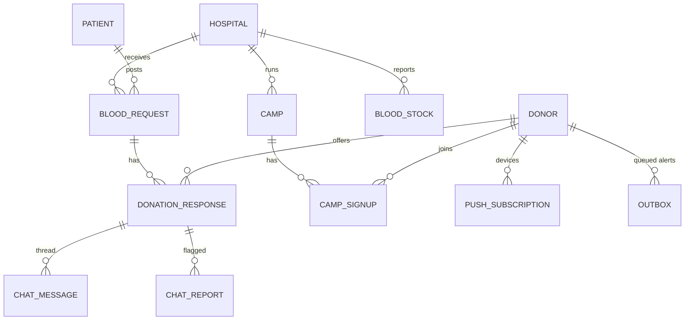

# BloodLink architecture

GitHub renders the diagrams below. The rule that shapes everything: **only a hospital can confirm blood.**
Chat, check-in, forms and alerts can never change unit counts.

## 1. Components

## 2. A blood request, end to end

A donor **offer** has its own states: Interested, Contacted, Appointment Scheduled, Donation Completed, Cancelled, Ineligible.
Check-in (QR) records arrival only; **Donation Completed** is set only by the hospital's *Confirm donation*.

## 3. Main tables

## 4. Alerts and background jobs

`alert_donor()` never sends anything while a page is being served. It writes one `outbox` row per channel the person
chose (SMS, WhatsApp, email, push). `flask --app app jobs` (cron, every 5 minutes) then:

| job | what it does |
|---|---|
| `expire` | closes requests past their deadline |
| `reminders` | appointment reminders 24 h and 2 h before, once each |
| `escalate` | widens urgent requests nobody answered, tells the hospital and patient |
| `deliver` | sends queued messages, retries 3 times, marks the rest failed or skipped |
| `cleanup` | retention clean-up, expired shared locations, old outbox rows |

Every job is safe to run twice (dedupe keys and "sent" markers). With no provider configured messages are marked
*skipped*, so nothing is sent by accident.

## 5. Security and privacy design

* CSRF token on every state-changing request (also for the JSON chat endpoints, via `X-CSRFToken`).
* Strict Content-Security-Policy: scripts only from this site; the chat, scan and push scripts are plain files.
* Object-level authorization: other people's requests, offers and conversations return **404**.
* Passwords hashed; reset and verification links are signed, expire, and a reset link dies when the password changes.
* Optional TOTP two-factor login (RFC 6238), secret encrypted at rest, one-time recovery codes. `REQUIRE_2FA_ROLES`
  can make it mandatory for admins and hospitals.
* Rate limits (memory, or Redis when `REDIS_URL` is set) on login, reset, chat, check-in guesses, API and AI calls.
* Chat: only the donor, the patient's family and the hospital read a thread; admins only after a report; shared
  locations hide after 6 h and are erased after 24 h; money/link messages are flagged automatically.
* Data minimisation: public pages, the public API and CSV exports never contain names, phones or emails.
* Logs carry a request id and never contain query strings, bodies, messages or locations.

## 6. Decisions worth knowing

* **Polling, not WebSockets**, for chat: works on any host, passes the CSP, no sticky sessions.
* **Rules, not machine learning**, for matching, the paste-a-message parser and the money detector: explainable and
  testable. The only outside AI call is the optional *Translate* button.
* **Two schema paths:** the original `create_all()` + additive `_migrate_schema()` (default, zero setup) and Alembic
  (`USE_ALEMBIC=1`, used on Render). `flask db stamp head` adopts an existing database.
